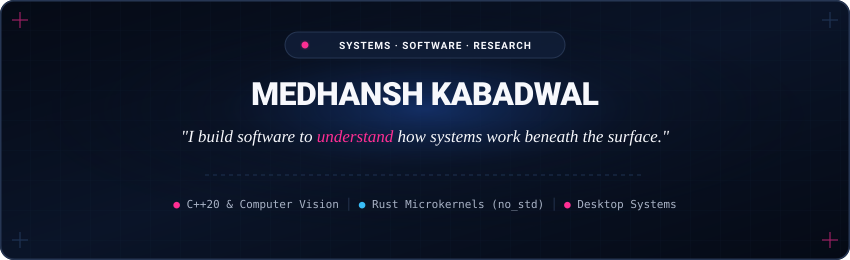

<p align="center">
  
</p>

<p align="center">
  <a href="https://medhansh5.github.io/medhansh5/"></a>
  <a href="https://github.com/medhansh5?tab=repositories"></a>
  <a href="https://www.linkedin.com/in/medhansh80/"></a>
  <a href="mailto:medhansh5@proton.me"></a>
</p>

<p align="center">
  <strong>Student engineer based in India.</strong> Building systems from first principles.
</p>

---

### ⚡ Flagship Systems

<table>
  <tr>
    <td width="33%" valign="top">
      <h4><a href="https://github.com/medhansh5/Blindside">Blindside</a></h4>
      <p><b>Physical Privacy Daemon</b></p>
      <p>Catches shoulder-surfers with your webcam and instantly blanks the display before they can read it.</p>
      <p><code>C++20</code> · <code>OpenCV</code> · <code>Win32 / X11</code></p>
      <hr>
      <p>🔒 <b>Zero network.</b> Zero telemetry. 100% local CPU inference.</p>
    </td>
    <td width="33%" valign="top">
      <h4><a href="https://github.com/medhansh5/Janus">Janus OS</a></h4>
      <p><b>Capability Microkernel</b></p>
      <p>Bare-metal x86_64 microkernel where memory and hardware access require unforgeable typed handles.</p>
      <p><code>Rust no_std</code> · <code>x86_64</code> · <code>Virtio</code></p>
      <hr>
      <p>🛡️ <b>Zero ambient authority.</b> Device drivers run in unprivileged Ring 3.</p>
    </td>
    <td width="33%" valign="top">
      <h4><a href="https://github.com/medhansh5/Rove">Rove</a></h4>
      <p><b>Native File Manager</b></p>
      <p>Brings macOS Finder ergonomics (Miller columns, spacebar Quick Look) to Windows 11.</p>
      <p><code>TypeScript</code> · <code>React 19</code> · <code>Electron</code></p>
      <hr>
      <p>⚡ <b>Native speed.</b> Fast <code>attrib.exe</code> scanner & safe Recycle Bin deletes.</p>
    </td>
  </tr>
</table>

<details>
<summary><b>📐 Deep Architecture & Pipelines (Click to expand)</b></summary>
<br>

#### Blindside: Real-Time Gaze Pipeline
```text
Webcam Sensor (Local Frame)
   │
   ▼
[YuNet CNN Inference] ──> 5-Point Facial Landmarks (Eyes, Nose, Mouth)
   │
   ▼
[cv::solvePnP 3D Model] ──> Head Pose Vector (Pitch / Yaw / Roll)
   │
   ▼
[Spatial Gaze Filter] ──> Secondary Face in ±30° Yaw / ±25° Pitch?
   │
   ▼
[Dwell Timer Hysteresis (>1.0s)] ──> Confirm Genuine Observer
   │
   ▼
[Threat Evaluation & Platform Redaction]
   ├── Windows: Alpha Click-Through Overlay (WM_NCHITTEST Pass-Thru)
   ├── Linux X11: Override-Redirect Opaque Window Mask
   └── Linux Wayland: Desktop Notification & loginctl Session Lock
```

#### Janus OS: Privilege & Capability Boundaries
```text
┌────────────────────────────────────────────────────────┐
│               USERSPACE (Ring 3 Tasks)                 │
│                                                        │
│  [Init Task]      [Virtio Driver]      [Sandboxed App] │
│  (Root CSpace)    (Ring 3 Userspace)   (Isolated Mem)  │
│        │                 │                    │        │
│        │ CPtr Manifest   │ IOPort / DMA Cap   │ IPC Cap│
└────────┼─────────────────┼────────────────────┼────────┘
═════════╪═════════════════╪════════════════════╪═════════
   syscall / sysret ABI & Capability Verification Barrier 
═════════╪═════════════════╪════════════════════╪═════════
┌────────▼─────────────────▼────────────────────▼────────┐
│               MICROKERNEL (Ring 0 Core)                │
│                                                        │
│  [CSpace Manager]      [Preemptive Sched] [Phys MMU]   │
│  (Handle Validation)   (IRQ0 Timer / Runq) (Frame Alloc)│
└────────────────────────────────────────────────────────┘
```

#### Rove: Electron IPC Architecture
```text
React Renderer (Miller Columns, Quick Look Previews, Tag Bar)
   │
   ▼  Context Bridge (Typed IPC Boundary)
Electron Main (attrib.exe System Scanner, PowerShell Recycle Bin Bridge)
```

</details>

---

### 🧪 Experiments & Research

| Project | What It Is | Tech Stack | Link |
|---|---|---|---|
| **[spectre](https://github.com/medhansh5/spectre)** | Invisible Linux X11 HUD. `Ctrl+Shift+Space` queries Gemini on your screen. | Python · PyQt · Gemini 2.0 | [Repository ↗](https://github.com/medhansh5/spectre) |
| **[90s-nostalgia](https://github.com/medhansh5/90s-nostalgia)** | Windows 95 desktop in 1 HTML file with live synthesized 8-bit chiptune audio. | Vanilla JS · Web Audio API | [Live Demo ↗](https://medhansh5.github.io/90s-nostalgia/) |
| **[FusionNet](https://github.com/medhansh5/FusionNet-Multi-Modal-Edge-AI)** | Motorcycle hazard AI: pairs camera vision with 100Hz IMU vibration telemetry. | C++ · PyTorch · Edge AI | [](https://doi.org/10.5281/zenodo.20971224) |
| **[PotholeNet](https://github.com/medhansh5/PotholeNet)** | Road anomaly classifier filtering sensor noise at ~0.15ms/sample with BallTree DBSCAN. | Python · PostGIS · DBSCAN | [Repository ↗](https://github.com/medhansh5/PotholeNet) |
| **[ShadowMap](https://github.com/medhansh5/ShadowMap)** | Road mapping interface with suspension displacement tracking and Kalman-filtered GPS. | Leaflet.js · Flask · Kalman | [Repository ↗](https://github.com/medhansh5/ShadowMap) |
| **[Aegis](https://github.com/medhansh5/Aegis)** | Discord moderation engine with permission risk audits and anti-raid heuristics. | Java 26 · Virtual Threads | [Repository ↗](https://github.com/medhansh5/Aegis) |

---

### 🛠️ Disciplines & Primitives

```text
├── Operating Systems      [Capability Spaces, Synchronous IPC, Preemptive IRQ0, Ring 3 Drivers]
├── Low-Level Systems      [Zero-Allocation Loops, Ring Buffers, C++20 / Rust Memory Models, FFI]
├── Computer Vision        [YuNet Face Detection, 6D solvePnP, Spatial Gaze Geometry, EAR Blink]
├── Desktop Architecture   [Win32 DWM, X11 Override-Redirect, Wayland Protocols, Electron IPC]
└── Signal Processing      [Butterworth SOS Cascades, Kalman State Estimation, BallTree DBSCAN]
```

---

### 🔨 On the Workbench

* **Janus OS:** Userspace capability delegation protocols & Virtio request buffers for Ring 3 storage.
* **Blindside:** Multi-monitor coordinate transforms & click-through passthrough across Linux window managers.
* **Rove:** Background directory indexing & NTFS long-path edge case handling.

---

<p align="center">
  <em>"What looks like ruin from outside is just construction from mine."</em><br><br>
  <sub>Engineered from first principles · <a href="https://medhansh5.github.io/medhansh5/">medhansh5.github.io/medhansh5</a></sub>
</p>
